<p align="center">
  
</p>

# Forma

A local-first desktop planner for focused study, daily planning, and time tracking.

Keep university subjects, personal projects, and everyday tasks in one place. Choose what to work on today, start a focus session, and see where your time goes. No account or separate Java installation required.

[Русский](README.ru.md) · [Architecture](docs/architecture.md) · [Verification](docs/verification.md) · [Release guide](docs/releasing.md)

## What you can do

- **Plan your day.** Select tasks yourself or generate a suggestion from deadlines and priorities. Review and reorder the plan before saving it.
- **Organize projects and subjects.** Nest subjects inside a study project; see tasks across the whole project or one subject.
- **Keep deadlines visible.** Use the deadline calendar, priorities, search, and active/completed task filters.
- **Track focused work.** Run a general, project, or task timer. Pause, resume, take a timed break, and recover an active session after restarting.
- **Review your activity.** Daily totals, editable session history, project statistics, and an annual activity heatmap.
- **Make it yours.** English and Russian, 17 color themes, a compact sidebar, navigation history, and keyboard shortcuts. Optional native sidebar glass on macOS.

## Platform status

Forma is an early preview, currently version **0.2.0**.

| Platform                      | Package                     | Status                                                                        |
| ----------------------------- | --------------------------- | ----------------------------------------------------------------------------- |
| macOS, Apple Silicon          | `Forma-macos-arm64.zip`     | Built and tested locally; ad-hoc signed, not notarized                        |
| Windows, x64                  | `Forma_0.2.0_x64-setup.exe` | Build scripts and CI prepared; first Windows build and manual testing pending |
| Intel Mac, Windows ARM, Linux | —                           | No release package maintained yet                                             |

Source availability does not mean a downloadable release has already been published. Once a release is published, use the repository's **Releases** page. Maintainer builds are also available as artifacts of successful **Desktop builds** runs in Actions.

### macOS

Unzip the package, move `Forma.app` to Applications, and open it. The configured minimum is macOS 12; older macOS versions have not been manually verified. Native Liquid Glass requires macOS 26; earlier versions use a fallback.

The preview does not have an Apple Developer ID signature or notarization. Downloaded builds may be blocked by Gatekeeper. See Apple's [instructions for opening an app from an unidentified developer](https://support.apple.com/guide/mac-help/open-a-mac-app-from-an-unknown-developer-mh40616/mac).

### Windows

Run the x64 setup executable. It installs for the current user. The installer includes a WebView2 bootstrapper; if WebView2 is missing, its initial download needs internet. Java is bundled. Windows builds currently have no publisher code signature and may trigger SmartScreen.

## Your data

Tasks, projects, plans, settings, and focus history live in a local SQLite database. Forma has no account system, cloud sync, or telemetry implemented. The UI talks to a token-protected backend on `127.0.0.1`; it does not send task data to a remote server.

| Platform | Data directory                                     |
| -------- | -------------------------------------------------- |
| macOS    | `~/Library/Application Support/app.forma.desktop/` |
| Windows  | `%APPDATA%\app.forma.desktop\`                     |

The directory contains `forma.sqlite`, diagnostic logs, and `Backups/`. The database is not encrypted. Automatic snapshots support upgrades; there is no restore/import screen yet. For a manual backup, quit Forma and copy the entire data directory. Avoid copying only the SQLite file while the app is running.

Development runs use the same application identifier as installed Forma. Use an isolated macOS/Windows user account for experiments with storage or migrations. Automated tests and the packaged backend smoke test use temporary databases.

## Build from source

Requirements: Node.js 22, Rust stable with Cargo, Python 3, and a JDK with `jlink`. The packaging workflow uses **Temurin 25** and Gradle Wrapper 9.1; Java source/bytecode targets 21. The first build downloads dependencies.

- **macOS arm64:** install Xcode Command Line Tools (`xcode-select --install`).
- **Windows x64:** install Visual Studio 2022 Build Tools with **Desktop development with C++**, a Windows SDK, and WebView2. Use **Developer PowerShell for VS 2022**, targeting x64. Set `JAVA_HOME` to an x64 JDK.

```sh
npm ci
npm run prepare:backend
npm run desktop:dev
```

`prepare:backend` runs Java tests, builds the backend JAR, creates a reduced Java runtime, and compiles the native launcher. Run it again after backend changes. `npm run dev` alone only serves the web UI; persistence requires the desktop host.

```sh
npm test
npm run build
npm run format:check
cargo fmt --manifest-path src-tauri/Cargo.toml --check
npm run package:desktop
```

`package:desktop` selects the host platform. You can also use `package:macos` or `package:windows`. It packages the app and runs an isolated backend smoke test covering authentication, hierarchy, day plans, focus recovery, statistics, backups, and shutdown.

Output goes to **`release.noindex/`**, including checksums and a source archive. Set `FORMA_RELEASE_DIR` to choose another destination. Packaging replaces the package at that destination; it does not install an update or modify user databases. Generated caches stay in `dist.noindex/`, `backend/build.noindex/`, and `src-tauri/target.noindex/`.

## Project layout

```text
src/          React + TypeScript UI, themes, state, and frontend tests
src-tauri/    Rust desktop host, native menus, window material, backend bridge
backend/      Java + Spring Boot API, SQLite repositories, migrations, tests
scripts/      Native launchers, runtime preparation, packaging, smoke checks
docs/         Architecture, verification record, and release process
```

The desktop shell uses Tauri and the system webview. The Java backend and reduced runtime ship inside the app. SQLite schema migrations are versioned and checksummed.

## Current limits and plans

Windows needs a successful CI run and real installation/UI testing before a Windows release is considered verified. macOS notarization and Windows publisher signing are not configured. There is no automatic updater.

Atlas, sync, collaboration, accounts, recurring tasks, notifications, a trash/undo flow, and a backup restore screen are future work. Auto-plan currently uses explicit rules, with no ML model or external AI service.

## License

Forma source code is available under the [MIT License](LICENSE). Dependencies and the bundled Java runtime retain their own licenses; see [third-party notices](THIRD_PARTY_NOTICES.md). The VS Code theme attribution is preserved in [licenses/VSCode-MIT.txt](licenses/VSCode-MIT.txt).
